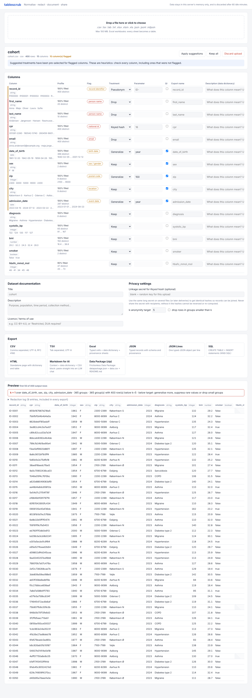

# tablescrub

A small, self-hosted web app for getting tabular research data **ready to share**, either with
another institution or with an AI assistant. Upload a spreadsheet, review what looks sensitive,
choose a treatment for each column, check k-anonymity, then export a documented copy in the format
the recipient needs.



Java 21 · [Javalin](https://javalin.io) 6 · [htmx](https://htmx.org) 2 (served locally, no CDN) · Thymeleaf · Apache POI · Commons CSV · Jackson.

```
upload ─► reader ─► RawTable ─► Profiler ─► Table (common IR) ─► Redactor(Plan) ─► RedactedTable ─► writer
          csv/tsv              clean headers,  typed columns,      drop/mask/hash/     + data dictionary   csv tsv xlsx json jsonl
          xlsx/xls             ISO dates,      PII hints           pseudonym/generalize + redaction log    sql html md(AI) datapackage.zip
          json/jsonl           true/false,                         suppress-rare/round  + k-anonymity
```

## Run it

```bash
cd projects/tablescrub
mvn package            # runs the 28 tests and builds a self-contained jar
java -jar target/tablescrub-0.1.0.jar
# open http://127.0.0.1:7070 and upload samples/cohort.csv (400 synthetic patients)
```

Development: `mvn compile exec:java`. Set `TABLESCRUB_DEV=true` to reload templates without restarting.

| env var | default | meaning |
|---|---|---|
| `HOST` / `PORT` | `127.0.0.1` / `7070` | bind address. Localhost by default; see *Security* before exposing it |
| `TABLESCRUB_MAX_UPLOAD_MB` | `100` | upload size limit |
| `TABLESCRUB_MAX_ROWS` | `1000000` | rows read per table (extra rows are skipped, with a warning) |
| `TABLESCRUB_TTL_MINUTES` | `60` | idle uploads are dropped from memory after this long |
| `TABLESCRUB_MAX_UPLOADS` | `50` | when full, the least recently used upload is evicted |

## What it does

**Input formats.** CSV/TSV/TXT, with the delimiter detected (`,` `;` tab `|`) and the encoding detected
(BOM, UTF-8, falling back to Windows-1252). Decimal commas (`68,5`) are converted when the delimiter
is not a comma. Also Excel `.xlsx/.xlsm/.xls` (every non-empty sheet becomes a table and the header
can start on any row; dates, formulas and numbers are read as typed values), JSON (an array of objects,
an object that contains one, or an array of arrays) and JSON Lines. Nested JSON is flattened to
`a.b` columns. Files with unknown extensions are identified by their content.

**Common intermediate representation** (`model.Table`). A rectangular grid of nullable strings in
canonical form: ISO-8601 dates and datetimes, `.` as the decimal separator, `true/false`. Blank,
`NA`, `null`, `-` and similar become missing values. Empty or duplicate headers are renamed. Each
column carries an inferred type (integer, decimal, boolean, date, datetime or string) and a profile
(fill rate, distinct count, min and max, samples). Codes with leading zeros (`0042`, postcodes, CPR
numbers) stay text. Every export is generated from this model, and the tests check that
CSV, TSV, Excel, JSON and JSONL exports read back to the same table.

**Sensitive-data hints.** Header keywords in English, Danish, Swedish, Norwegian, German and Dutch,
plus value patterns: e-mail addresses, Danish CPR numbers (with a date check), US SSNs, phone numbers,
IPv4 addresses, IBANs, long free text, and all-unique columns. Columns are graded as *direct*
identifiers (red) or *quasi*-identifiers (amber), and each gets a pre-selected treatment.
Quasi-identifiers are ticked for the k-anonymity check.

**Treatments per column**

| action | effect | parameter |
|---|---|---|
| Keep | unchanged | |
| Drop | column removed | |
| Mask | every value becomes `[REDACTED]` | replacement text |
| Keyed hash | HMAC-SHA256 hex. The same input always gives the same output, so records stay joinable | hex length (16) |
| Pseudonym | `ID-0001`, `ID-0002`… in order of first appearance. The mapping is never exported | prefix |
| Generalize | dates → `year`/`month`/`decade`; numbers → bins (`30-39`); text → first N chars (`21**`) | as listed |
| Suppress rare | values seen fewer than k times become `[RARE]` (small-cell suppression) | k (5) |
| Round | numbers rounded to N decimals; negative N rounds to tens, hundreds… | N (0) |

You can also rename columns and write a description for each one. The descriptions go into the data
dictionary.

**k-anonymity.** Tick *QI* on the columns an attacker could know (age, sex, postcode, dates, rare
diagnoses). The live preview shows the smallest group size *k* after your treatments, and how many
rows are in groups below the target. "Drop rows in groups smaller than k" removes those rows.

**Exports.** All are built from the same redacted table and carry the same documentation.

| format | contents |
|---|---|
| CSV / TSV | UTF-8, RFC 4180 |
| Excel | typed cells (numbers, real dates) with `data`, `data_dictionary` and `provenance` sheets |
| JSON | `{name, provenance, schema, rows:[typed records]}` |
| JSON Lines | one typed object per line |
| SQL | ANSI `CREATE TABLE` + batched `INSERT` statements, redaction log as comments |
| HTML | standalone page with provenance, data dictionary and data |
| **Markdown for AI** | context note, provenance, data dictionary, redaction log, then the data as a CSV block. Paste the whole file into an LLM chat |
| **Data Package (zip)** | [Frictionless](https://specs.frictionlessdata.io/data-package/) `datapackage.json` (Table Schema, licence, sources, `x-redaction` log and k stats) + `data.csv` + `README.md` |

## API (for scripts and pipelines)

```bash
# Profile a file: columns, types and PII hints (no cell values are returned)
curl -F file=@samples/cohort.csv http://127.0.0.1:7070/api/inspect

# Redact with the suggested treatments ("auto") and get Markdown for an LLM
curl -F file=@samples/cohort.csv -F format=md http://127.0.0.1:7070/api/redact -o cohort.md

# Explicit plan. Columns not listed get suggestions because of "auto": true
curl -F file=@samples/cohort.csv -F format=datapackage -o cohort.zip \
  -F 'plan={"auto":true,"k":5,"suppressRows":true,"title":"Cohort extract","license":"CC-BY-4.0",
            "columns":{"date_of_birth":{"action":"GENERALIZE","param":"decade","qi":true},
                       "zip":"DROP","city":{"action":"KEEP","qi":true},"sex":{"action":"KEEP","qi":true},
                       "admission_date":{"action":"GENERALIZE","param":"year"}}}' \
  http://127.0.0.1:7070/api/redact
# → k = 5 over [date_of_birth, sex, city]; 219 of 400 rows suppressed (shown in the README inside the zip)

curl http://127.0.0.1:7070/api/formats   # list the format ids
```

Other plan fields: `secret` (linkage key for HASH), `sheet` (form field: table index for workbooks),
`description`. A column's value can be a bare action string or an object
`{action, param, qi, description, rename}`.

## Security and privacy notes

- Uploads are held **in memory only**. Nothing is written to disk. *Discard upload* removes the data
  at once, and idle uploads expire. Upload IDs are 128-bit random values.
- No external calls. htmx is bundled in the jar. A strict Content-Security-Policy is set
  (`script-src 'self'`).
- **Keyed hash**: CPR and other national IDs come from a small space, so an unkeyed hash could be
  reversed by brute force. That is why HMAC is used. Without your own secret, each upload gets a random
  key, so its hashes cannot be linked to other files. Supply the same long secret to link several
  deliveries, and never send the secret to the recipient. Under GDPR, keyed-hashed data is still
  *pseudonymised* personal data, not anonymous data.
- The app has no login and no CSRF protection. It is meant to run on your own machine (the
  default bind is 127.0.0.1) or behind your institution's authenticating reverse proxy.

## Limitations

- The PII detector is heuristic and cannot catch everything. It will miss identifiers hidden in
  free text, and can flag harmless columns. A person must review every column.
- k-anonymity does not protect against attribute disclosure (l-diversity/t-closeness) or linkage
  across releases. Treat it as one signal, not proof that data is anonymous.
- The whole table is held in memory. About 1M rows × 20 columns is comfortable with a 2 GB heap.
- Excel and JSON store numbers as numbers, so trailing zeros (`26.0` → `26`) are not kept in those
  formats. CSV/TSV keep the original text.
- Not supported yet: ODS, Parquet, SPSS/Stata/SAS files, multi-table relational exports, and saving
  or loading treatment plans in the UI. See the repository `BACKLOG.md`.
